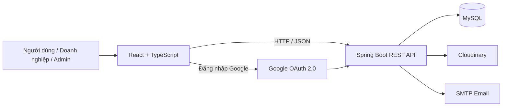

# Part-time Hiring Platform

**Nền tảng kết nối người tìm việc bán thời gian với doanh nghiệp và cửa hàng.**

Ứng dụng hỗ trợ tìm kiếm việc làm, gửi đơn ứng tuyển, quản lý tuyển dụng và quản trị dữ liệu trên một hệ thống tập trung. Dự án tổ chức thành hai ứng dụng độc lập: giao diện React và REST API Spring Boot, sử dụng MySQL để lưu trữ dữ liệu.

## Mục lục

- [Tổng quan](#tổng-quan)
- [Công nghệ sử dụng](#công-nghệ-sử-dụng)
- [Chức năng theo vai trò](#chức-năng-theo-vai-trò)
- [Kiến trúc hệ thống](#kiến-trúc-hệ-thống)
- [Cấu trúc thư mục](#cấu-trúc-thư-mục)
- [Hướng dẫn cài đặt và chạy](#hướng-dẫn-cài-đặt-và-chạy)
- [Các lệnh thường dùng](#các-lệnh-thường-dùng)
- [Tác giả](#tác-giả)

## Tổng quan

Part-time Hiring Platform phục vụ ba nhóm người dùng:

- **Người tìm việc:** tìm công việc phù hợp, quản lý hồ sơ và theo dõi đơn ứng tuyển.
- **Doanh nghiệp:** quản lý cửa hàng, tin tuyển dụng, ứng viên và nhân sự.
- **Quản trị viên:** quản lý tài khoản, xét duyệt doanh nghiệp và quản lý nội dung trên nền tảng.

Dữ liệu tuyển dụng được tổ chức theo mối quan hệ **doanh nghiệp → cửa hàng → tin tuyển dụng → đơn ứng tuyển → hồ sơ nhân sự**. Ngành nghề và ca làm giúp người tìm việc thu hẹp kết quả theo nhu cầu.

## Công nghệ sử dụng

| Thành phần | Công nghệ |
|---|---|
| Backend | Java 17+, Spring Boot 4.0.6, Maven Wrapper |
| REST API | Spring Web, Jakarta Validation |
| Xác thực | Spring Security, JWT, OAuth 2.0 Client |
| Truy cập dữ liệu | Spring Data JPA, Hibernate, MySQL Connector/J |
| Ánh xạ dữ liệu | MapStruct, Lombok |
| Frontend | React 19, TypeScript 6, Vite 8 |
| Điều hướng | React Router |
| Giao diện | CSS Modules, Lucide React, Framer Motion |
| Biểu đồ | Recharts |
| Lưu trữ ảnh | Cloudinary |
| Email | Spring Mail, SMTP |
| Kiểm tra mã | ESLint, TypeScript, Maven Test |

## Chức năng theo vai trò

### Xác thực và tài khoản

- Đăng ký tài khoản người dùng và đăng nhập bằng mật khẩu.
- Tích hợp đăng nhập Google thông qua OAuth 2.0.
- Xác thực yêu cầu bằng JWT lưu trong cookie HttpOnly, refresh token và bảo vệ CSRF.
- Đổi mật khẩu, khôi phục mật khẩu qua email và thu hồi phiên đăng nhập.
- Phân quyền theo các vai trò `USER`, `EMPLOYER` và `ADMIN`.
- Xác minh email bằng OTP trong quy trình nộp hồ sơ doanh nghiệp.

Chức năng quản trị, API và kết quả triển khai: [Admin features](docs/ADMIN_FEATURES.md) · [Báo cáo ADMIN](docs/ADMIN_TASK_REPORT.md).

Chi tiết API và cách kiểm thử: [Authentication / Authorization](docs/AUTHENTICATION.md).

Chức năng người tìm việc, API và hướng dẫn sử dụng: [User features](docs/USER_FEATURES.md).

### Người tìm việc — User

- Xem và cập nhật hồ sơ cá nhân.
- Đổi ảnh đại diện và quản lý CV, kỹ năng, kinh nghiệm ứng tuyển.
- Xem danh sách và thông tin chi tiết công việc.
- Tìm kiếm theo tên công việc và cửa hàng.
- Lọc công việc theo ngành nghề, ca làm, mức lương và địa chỉ.
- Gửi đơn ứng tuyển kèm số điện thoại và lời nhắn.
- Theo dõi danh sách công việc đã ứng tuyển và kết quả xử lý.
- Sửa/rút đơn đang chờ, lưu việc yêu thích và xem lịch sử làm việc.
- Viết đánh giá từ lịch sử làm việc đã xác nhận.
- Nhận thông báo, trao đổi với doanh nghiệp và phản hồi lịch phỏng vấn.
- Gửi và theo dõi báo cáo tin tuyển dụng.
- Xem thông tin đánh giá được hiển thị tại trang chi tiết công việc.
- Nộp hồ sơ xác minh doanh nghiệp và theo dõi trạng thái xét duyệt.

### Doanh nghiệp — Employer

- Xem dashboard về hoạt động tuyển dụng.
- Quản lý thông tin hồ sơ doanh nghiệp.
- Tạo và quản lý các cửa hàng, chi nhánh.
- Xem thông tin tuyển dụng và nhân sự theo cửa hàng.
- Tạo, cập nhật và quản lý tin tuyển dụng.
- Thiết lập mức lương, số lượng tuyển, ngành nghề, ca làm và hạn ứng tuyển.
- Quản lý ảnh của tin tuyển dụng.
- Xem danh sách ứng viên và xử lý đơn ứng tuyển.
- Quản lý hồ sơ nhân sự được tạo từ quá trình tuyển dụng.
- Ghi nhận nhân sự nghỉ việc hoặc bị chấm dứt làm việc.

### Quản trị viên — Admin

- Xem dashboard thống kê tổng quan hệ thống.
- Quản lý danh sách người dùng và khóa/mở khóa tài khoản.
- Quản lý danh sách và trạng thái doanh nghiệp.
- Xem, xét duyệt và từ chối hồ sơ xác minh doanh nghiệp.
- Quản lý tin tuyển dụng và trạng thái cửa hàng.
- Quản lý danh mục ngành nghề.
- Quản lý các ca làm việc.
- Xem và xóa đánh giá cửa hàng.

## Kiến trúc hệ thống



Backend tổ chức theo các lớp:

```text
Controller → Service → Repository → Database
                 ↕
            DTO / Mapper
```

- **Controller:** tiếp nhận yêu cầu HTTP và trả phản hồi API.
- **Service:** xử lý quy tắc nghiệp vụ và giao dịch dữ liệu.
- **Repository:** truy vấn và lưu trữ dữ liệu thông qua Spring Data JPA.
- **DTO / Mapper:** tách dữ liệu trao đổi qua API khỏi entity lưu trữ.
- **Security:** cấu hình xác thực, JWT, OAuth và phân quyền.

## Cấu trúc thư mục

```text
Parttime_Hiring_Plaform_Project/
├── ParttimeHiringBackend/
│   ├── .mvn/                          # Cấu hình Maven Wrapper
│   ├── src/
│   │   ├── main/
│   │   │   ├── java/tanhs/fudn/parttime_hiring_plaform_project/
│   │   │   │   ├── configuration/     # Cấu hình ứng dụng
│   │   │   │   ├── controller/        # REST API theo nhóm chức năng
│   │   │   │   ├── dto/               # Request và response
│   │   │   │   ├── entity/            # Mô hình dữ liệu JPA
│   │   │   │   ├── exception/         # Xử lý ngoại lệ
│   │   │   │   ├── mapper/            # Ánh xạ entity và DTO
│   │   │   │   ├── repository/        # Truy cập dữ liệu
│   │   │   │   ├── scheduler/         # Tác vụ theo lịch
│   │   │   │   ├── security/          # Xác thực và phân quyền
│   │   │   │   └── service/           # Nghiệp vụ và triển khai
│   │   │   └── resources/
│   │   │       ├── application.yml
│   │   │       └── application-local.yml
│   │   └── test/                      # Kiểm thử backend
│   ├── mvnw
│   ├── mvnw.cmd
│   └── pom.xml
├── ParttimeHiringFrontend/
│   ├── public/                        # Tài nguyên tĩnh
│   ├── src/
│   │   ├── assets/                    # Hình ảnh và tài nguyên giao diện
│   │   ├── components/                # Thành phần dùng chung và layout
│   │   ├── pages/                     # Các trang User, Employer, Admin
│   │   ├── services/                  # Hàm gọi API
│   │   ├── App.tsx                    # Khai báo route
│   │   └── main.tsx                   # Điểm khởi tạo React
│   ├── package.json
│   └── vite.config.ts
├── database/
│   ├── schema_db.sql                  # Định nghĩa cấu trúc database
│   └── data.sql                       # Dữ liệu mẫu
└── README.md
```

## Hướng dẫn cài đặt và chạy

### 1. Yêu cầu môi trường

- **JDK 17 trở lên**; biến `JAVA_HOME` trỏ đến JDK đang sử dụng.
- **Node.js** tương thích với Vite 8; có thể dùng Node.js 22.12 trở lên thuộc nhánh 22.
- **npm** để cài đặt và chạy frontend.
- **MySQL** đang hoạt động tại `localhost:3306`.
- **Git** để lấy và quản lý mã nguồn.

Dự án có Maven Wrapper nên không cần cài Maven riêng.

### 2. Chuẩn bị database

Sử dụng database phát triển có tên `parttime_hiring_platform`. Cấu hình backend mặc định cho phép tạo database nếu chưa tồn tại và cập nhật cấu trúc bảng bằng Hibernate.

Nếu cần khởi tạo từ SQL, sử dụng các tập tin trong thư mục `database/` sau khi kiểm tra nội dung. **`schema_db.sql` chứa lệnh xóa database hiện có**; chỉ chạy trên database phát triển có thể khởi tạo lại. Kiểm tra tên bảng và dữ liệu trong `data.sql` trước khi import.

Thông tin kết nối mặc định:

| Thuộc tính | Giá trị |
|---|---|
| Host | `localhost` |
| Port | `3306` |
| Database | `parttime_hiring_platform` |
| Username | `root` |

Đặt thông tin đăng nhập MySQL trong PowerShell trước khi chạy backend:

```powershell
$env:DB_USERNAME = "root"
$env:DB_PASSWORD = "your_mysql_password"
```

### 3. Cấu hình dịch vụ

| Biến môi trường | Mục đích |
|---|---|
| `DB_USERNAME`, `DB_PASSWORD` | Tài khoản kết nối MySQL |
| `PORT` | Cổng backend; mặc định `8088` |
| `JWT_SIGNER_KEY` | Khóa ký JWT; tối thiểu 64 byte cho HS512 |
| `JWT_SECRET` | Giá trị cấu hình JWT bổ sung |
| `GOOGLE_CLIENT_ID`, `GOOGLE_CLIENT_SECRET` | Đăng nhập Google |
| `MAIL_USERNAME`, `MAIL_PASSWORD` | Tài khoản SMTP gửi email |
| `CLOUDINARY_CLOUD_NAME` | Tên cloud Cloudinary |
| `CLOUDINARY_API_KEY`, `CLOUDINARY_API_SECRET` | Thông tin truy cập Cloudinary |

Profile `local` cung cấp giá trị phát triển cho các cấu hình dịch vụ. Để sử dụng Google Login, gửi email và upload ảnh, cần cung cấp thông tin dịch vụ thật.

Profile `local` tự đọc file `.env` ở thư mục gốc hoặc thư mục backend khi chạy từ một trong hai thư mục này. Biến môi trường của tiến trình vẫn có độ ưu tiên cao hơn; các môi trường triển khai khác phải được cấu hình riêng. Không commit thông tin bí mật hoặc sử dụng khóa ký của profile `local` khi triển khai.

### 4. Chạy backend

Từ thư mục gốc dự án, mở một terminal:

```powershell
cd ParttimeHiringBackend
.\mvnw.cmd spring-boot:run '-Dspring-boot.run.profiles=local'
```

Với macOS/Linux:

```bash
cd ParttimeHiringBackend
./mvnw spring-boot:run -Dspring-boot.run.profiles=local
```

**API base URL:** `http://localhost:8088/parttime_hiring_platform`

Ví dụ kiểm tra API công khai:

```text
GET http://localhost:8088/parttime_hiring_platform/api/jobs
```

### 5. Chạy frontend

Mở terminal khác từ thư mục gốc dự án:

```bash
cd ParttimeHiringFrontend
npm ci
npm run dev
```

**Frontend mặc định:** `http://localhost:5173`

Sử dụng địa chỉ thực tế Vite in ra terminal. Các service frontend hiện trỏ đến backend tại `http://localhost:8088/parttime_hiring_platform`; nếu đổi cổng backend, cập nhật địa chỉ API tương ứng. Cấu hình CORS backend cũng cần khớp địa chỉ frontend.

### 6. Tài khoản phát triển

Backend tạo tài khoản mặc định khi username tương ứng chưa tồn tại:

| Vai trò | Username | Password |
|---|---|---|
| Admin | `admin` | `admin` |
| Employer | `employer` | `employer` |

Người tìm việc có thể tạo tài khoản qua trang `/register`. Nếu database đã có các tài khoản trên, bộ khởi tạo không ghi đè mật khẩu hiện có. Các tài khoản mặc định chỉ phục vụ phát triển cục bộ.

## Các lệnh thường dùng

### Backend — chạy trong `ParttimeHiringBackend/`

| Lệnh trên Windows | Mục đích |
|---|---|
| `.\mvnw.cmd spring-boot:run '-Dspring-boot.run.profiles=local'` | Chạy backend với profile local |
| `.\mvnw.cmd test` | Chạy kiểm thử backend |
| `.\mvnw.cmd package` | Kiểm thử và đóng gói ứng dụng |

Trên macOS/Linux, thay `.\mvnw.cmd` bằng `./mvnw`. Các integration test dùng MySQL theo cấu hình và có thể cập nhật database; chạy với database phát triển riêng.

### Frontend — chạy trong `ParttimeHiringFrontend/`

| Lệnh | Mục đích |
|---|---|
| `npm ci` | Cài dependency theo lockfile |
| `npm run dev` | Chạy development server |
| `npm run build` | Kiểm tra TypeScript và tạo bản build |
| `npm run lint` | Kiểm tra quy tắc mã nguồn |
| `npm run preview` | Xem trước bản build trên máy cục bộ |

## Tác giả

**Ho Si Tan**  
Software Engineering Student — FPT University Da Nang
