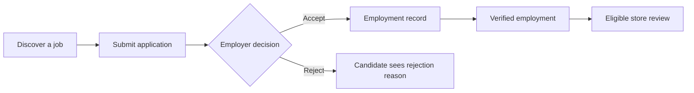
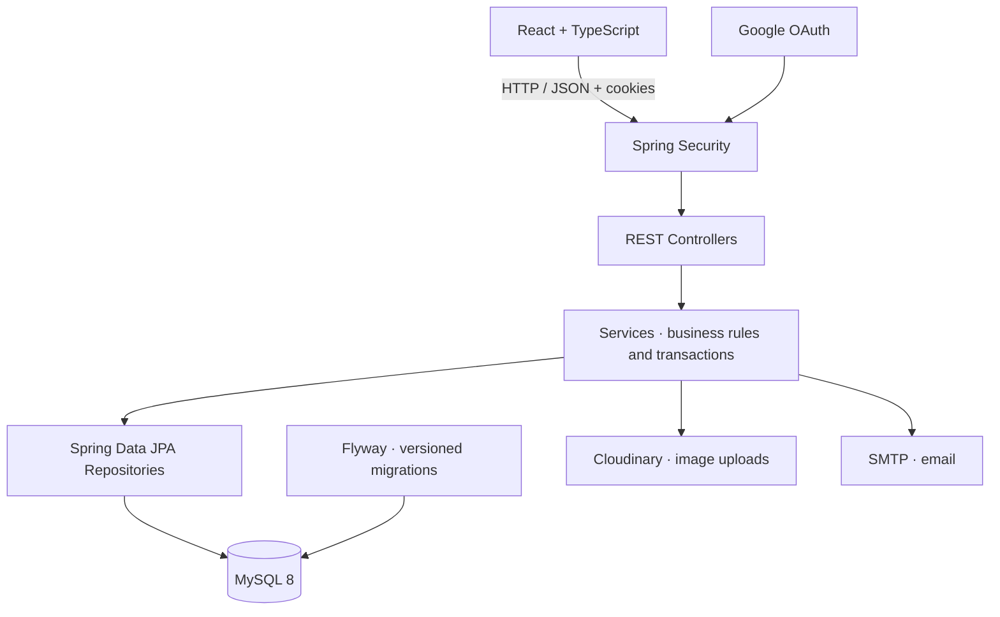

<div align="center">

# Part-time Hiring Platform

**A recruitment platform connecting job seekers, local businesses, and platform administrators.**

Java 21 · Spring Boot 4 · React 19 · TypeScript · MySQL 8 · Flyway

[Explore the Features](#features) · [Architecture](#architecture) · [Run Locally](#run-locally) · [Testing](#testing)

</div>

## Overview

Part-time Hiring Platform brings the recruitment process into one application: candidates discover jobs and submit applications, employers manage hiring across their stores, and administrators verify businesses and moderate platform activity.

The project covers the workflow beyond a job listing: application decisions lead to employment records, and verified employment determines eligibility for store reviews. Each role has a dedicated interface backed by a shared REST API.

**Engineering focus:** authentication and session security, resource ownership, consistent business state transitions, and reproducible database migrations.

## Features

| Role | Capabilities |
|---|---|
| **Job seeker** | Search and filter jobs; manage profile and PDF CV; apply, edit or withdraw pending applications; save jobs; track employment; exchange recruitment messages and respond to interviews; review eligible stores and report listings. |
| **Employer** | Manage company profile and stores; create and manage job postings, images, categories and shifts; review applicants and access authorized CVs; accept or reject applications; manage employment records and view recruitment dashboards. |
| **Administrator** | Review employer verification requests; manage user and employer status; approve stores; moderate job postings, reports and reviews; maintain categories and work shifts; view platform statistics. |

Shared account features include password registration/login, Google OAuth integration, password recovery, and email verification for employer onboarding.

### Recruitment workflow



## Engineering Decisions

| Concern | Implementation |
|---|---|
| **Authentication** | JWT authentication in HttpOnly cookies, CSRF protection for browser requests, BCrypt password hashing, refresh-token rotation and session revocation. |
| **Authorization** | Role restrictions at the API boundary, plus ownership checks for employer resources and private candidate CVs. |
| **Data consistency** | Service-layer transactions and pessimistic locks for sensitive transitions, including application decisions and verification; optimistic versioning on user accounts. |
| **API boundaries** | Request/response DTOs, Jakarta Validation, MapStruct mapping, and centralized API error handling. |
| **Database evolution** | Versioned Flyway migrations with Hibernate `validate`; separate histories for shared schema/reference data and development fixtures. |
| **Environment isolation** | Separate dev/prod datasource configuration. Dev fixtures check the target database; combined dev/prod profiles are rejected. Production has no default demo accounts. |
| **Private documents** | Candidate CVs are stored in profile data and downloaded through authorized API endpoints. Only fictional demo images have a dev static resource route. |

## Architecture

The backend is a layered Spring Boot application. The frontend is a separate React application consuming its REST API.



**Core data relationships:** employer → stores → job postings → applications → employment records → store reviews. Categories and work shifts are shared reference data used to classify and filter job postings.

### Technology Stack

| Layer | Technologies |
|---|---|
| Backend | Java 21 target, Spring Boot 4.0.6, Spring Web, Jakarta Validation |
| Security | Spring Security, JWT, OAuth 2.0 Client, BCrypt |
| Persistence | Spring Data JPA, Hibernate, MySQL 8, Flyway |
| Mapping | MapStruct, Lombok |
| Frontend | React 19, TypeScript 6, Vite 8, React Router 7 |
| UI | CSS Modules, Lucide React, Framer Motion, Recharts |
| Integrations | Cloudinary, Spring Mail / SMTP, Google OAuth |
| Verification | JUnit, Spring Boot Test, Spring Security Test, H2, MySQL migration tests, API smoke scripts |
| Local tooling | Maven Wrapper, npm, Docker, Python database utilities |

### Repository Structure

```text
ParttimeHiringBackend/
  src/main/java/.../
    controller/          HTTP endpoints
    service/             Business rules and transactions
    repository/          Data access
    entity/              Persistence models
    dto/ and mapper/     API contracts and mapping
    security/            Authentication and authorization
    configuration/       Application and migration configuration
  src/main/resources/
    application*.yml     Shared, dev, prod and local-alias configuration
    db/migration/        Shared Flyway migrations
    db/dev/data/         Development fixture definitions
  src/test/              Backend unit and integration tests
ParttimeHiringFrontend/
  src/pages/             Candidate, employer and administrator screens
  src/components/        Shared UI and layouts
  src/services/          API clients
  tests/                 Frontend test scripts
database/demo/           Fictional images and PDF resumes
scripts/database/        Database operations and live API smoke checks
```

## Run Locally

### Prerequisites

- JDK 21 with `JAVA_HOME` configured.
- Node.js compatible with Vite 8 and npm; Node.js 22.12+ on the 22.x line is supported.
- Docker Desktop for the local MySQL container.
- Python 3.11+ for the database utilities.

Commands below use PowerShell and start from the repository root. Maven Wrapper is included; a separate Maven installation is unnecessary.

### 1. Configure the environment

```powershell
Copy-Item .env.dev.example .env
```

Edit `.env` before starting the application:

| Variable | Value |
|---|---|
| `DEV_DB_URL` | `jdbc:mysql://localhost:3306/parttime_hiring_platform_dev` |
| `DEV_DB_USERNAME` | `root` for this local Docker setup |
| `DEV_DB_PASSWORD` | Your local MySQL root password |
| `DEMO_SEED_PASSWORD` | Your chosen demo password: at least 12 characters, at most 72 UTF-8 bytes |

The dev profile reads the root `.env` when the backend runs from its own directory. Keep this file private. Demo passwords are hashed during the first fixture migration; changing the environment value later does not reset existing accounts.

### 2. Start MySQL and create databases

The root `compose.yaml` runs local MySQL 8 using `.env` and the persistent `parttime-mysql-data` volume:

```powershell
docker compose up -d --wait
python scripts/database/manage.py init
```

The Compose file creates the dev database on first initialization. The Python command also creates the local prod verification schema. Use `DEV_DB_USERNAME=root` and set `DEV_DB_PASSWORD` in `.env` before starting. For an existing volume, the password must match its current MySQL root password; changing `.env` does not reset it.

If `mysql-parttime` was previously created with `docker run`, keep using `docker start mysql-parttime` followed by the Python command above. Compose cannot adopt that existing container automatically. To migrate it while retaining its data, first inspect its volume with `docker inspect mysql-parttime --format '{{range .Mounts}}{{if eq .Destination "/var/lib/mysql"}}{{.Name}}{{end}}{{end}}'` and set `MYSQL_VOLUME_NAME` in `.env` to that exact name (including anonymous volumes). Then stop it and rename it to an unused backup name before running Compose:

```powershell
docker stop mysql-parttime
docker rename mysql-parttime mysql-parttime-backup
docker compose up -d --wait
```

For Compose-managed containers, view logs with `docker compose logs -f mysql` and stop with `docker compose stop`. The database volume persists.

This creates `parttime_hiring_platform_dev` and a local `parttime_hiring_platform_prod` verification schema. It does not deploy a remote production environment.

### 3. Start the backend

```powershell
cd ParttimeHiringBackend
.\mvnw.cmd spring-boot:run '-Dspring-boot.run.profiles=dev'
```

Flyway creates the schema and development fixtures before the application becomes ready. The working directory matters because the default demo asset path is relative to the backend directory. `local` remains an alias for `dev`.

**API base:** `http://localhost:8088/parttime_hiring_platform`

**Public listing:** `GET /api/jobs/page`

On macOS/Linux, use `./mvnw` in place of `.\mvnw.cmd`.

### 4. Start the frontend

In another terminal, from the repository root:

```powershell
cd ParttimeHiringFrontend
npm ci
npm run dev
```

Open **http://localhost:5173**. The default frontend configuration expects the backend at port 8088; keep the API address and CORS configuration aligned if changing ports.

### 5. Explore the demo

All demo accounts use the `DEMO_SEED_PASSWORD` supplied during first initialization.

| Role | Suggested account | Try this |
|---|---|---|
| Administrator | `demo_admin_01` | Inspect dashboard statistics and pending verification requests. |
| Employer | `demo_employer_01` | Browse stores, job postings and applicant profiles. |
| Job seeker | `demo_user_01` | View applications, employment history and the private PDF CV. |

The canonical fixtures include **52 accounts, 10 employers, 24 stores, 80 job postings, 120 applications and 20 PDF CVs**. They also include rejected/withdrawn applications, pending verifications and moderation cases. Users `demo_user_39`–`40` are disabled; employers `demo_employer_09`–`10` are suspended.

Job dates are relative to the first seed date, so public listing counts can change as jobs expire. Demo companies, documents and resumes are fictional.

## Testing

The database refactor verification on **8 November 2026** recorded **137 passing backend tests**, including **5 real MySQL migration tests** and **3 migration configuration guard tests**. The frontend production build and live API smoke checks also passed. This is a recorded verification result, not a coverage percentage or a guarantee for later changes.

| Area | Verified behavior |
|---|---|
| Accounts and access | Authentication lifecycle, role restrictions and resource ownership. |
| Recruitment | Application handling, employment/review rules and public job visibility. |
| Migration safety | Empty schema initialization, fixture idempotency, rollback on conflicts, checksum validation and independent shared/dev version ordering. |
| Private CVs | Authorized candidate/employer downloads; access denied for unrelated employers and guests. |
| Live API smoke | Cookie/CSRF login, dashboards, candidate profile, demo images, disabled accounts and logout. |

### Backend tests

From `ParttimeHiringBackend`:

```powershell
.\mvnw.cmd test
```

Normal application tests use isolated H2 databases. The five MySQL tests are opt-in; provide `MYSQL_MIGRATION_TESTS=true`, `MYSQL_TEST_URL`, `MYSQL_TEST_USERNAME` and `MYSQL_TEST_PASSWORD` to include them. They create disposable `parttime_flyway_test_<uuid>` schemas rather than resetting dev or prod.

### Frontend checks

From `ParttimeHiringFrontend`:

```powershell
npm run build
node --experimental-strip-types --test tests/*.test.mjs
```

`npm run build` checks TypeScript and produces the Vite build. `npm run lint` is available separately; the recorded build result does not assert that repository-wide lint is clean.

For MySQL test setup, API smoke checks and backup/reset commands, see the [database operations guide](scripts/database/README.md).

## Configuration and Deployment Notes

- **Database ownership:** Flyway manages schema changes; Hibernate validates mappings. Shared migrations and dev fixtures use separate history tables. Do not edit applied migrations.
- **Production configuration:** explicitly select `prod` and supply the variables in [`.env.prod.example`](.env.prod.example). The profile does not import the local `.env`, seed demo accounts or expose demo images; secure cookies are enabled.
- **External services:** Google login, SMTP delivery and Cloudinary uploads require valid provider credentials. Local fallback configuration allows development startup but does not establish that these integrations work with real providers.
- **Private local files:** `.env`, backups under `.local/`, and working documentation under `docs/` are excluded from Git. Operational instructions needed for a fresh checkout are kept in this README and `scripts/database/README.md`.

## Author

**Ho Si Tan**

Software Engineering Student · FPT University Da Nang

[GitHub](https://github.com/Hositan26)
